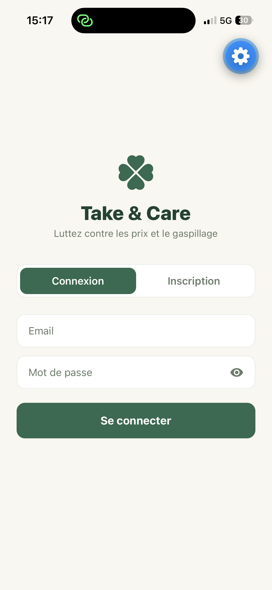
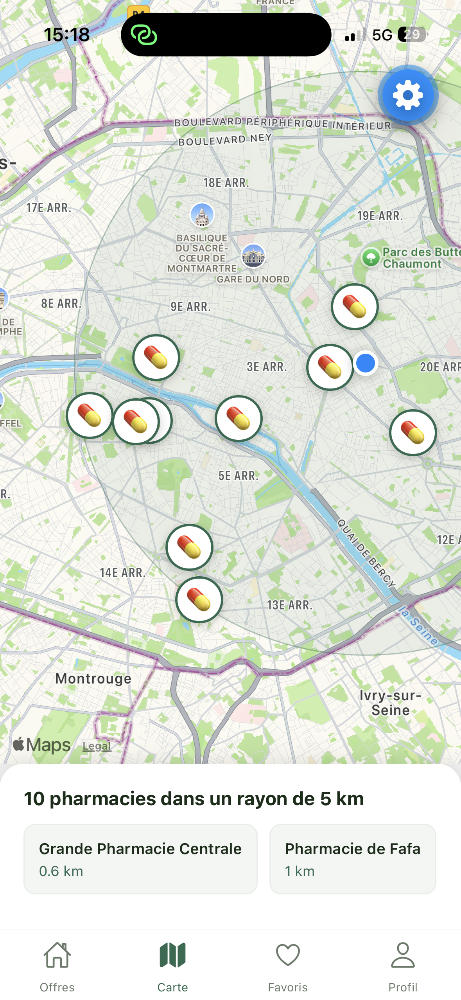
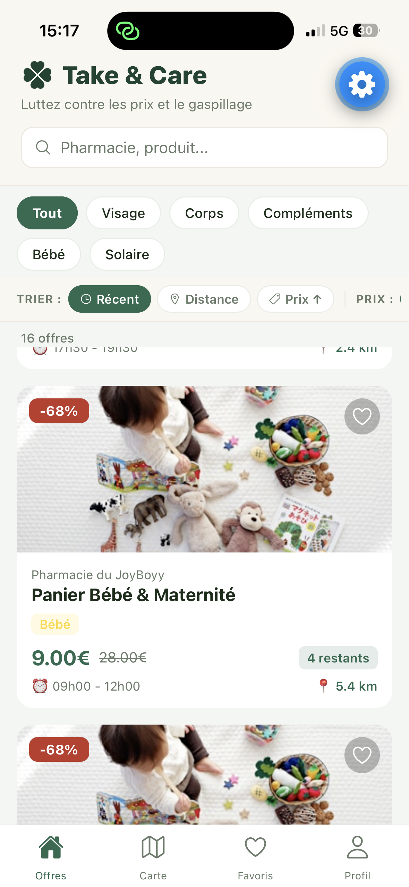
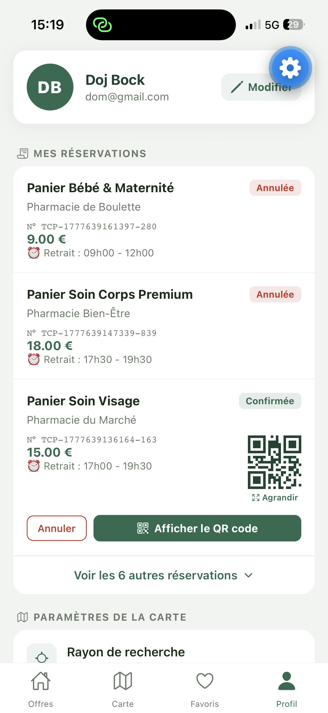

# TakeAndCare

> Application mobile anti-gaspillage qui permet aux pharmacies de vendre à prix réduit leurs cosmétiques proches de la date de péremption.


<p align="center">
  
  
  
  
</p>

## Le problème

Chaque année, les pharmacies jettent des produits cosmétiques encore parfaitement utilisables parce que leur date de péremption approche. TakeAndCare s'inspire du modèle de Too Good To Go : les pharmacies publient ces produits à prix réduit, les clients les réservent depuis l'application et viennent les récupérer en officine.

Le concept a été validé par des **entretiens avec des pharmaciens** portant sur la gestion de leurs stocks proches de la péremption et sur leurs conditions d'adoption d'un tel outil.

## Fonctionnalités

**Côté client**
- Catalogue de produits disponibles à prix réduit
- Carte interactive des pharmacies participantes
- Panier et réservation de produits
- Retrait en pharmacie grâce à un QR code

**Côté pharmacie**
- Tableau de bord de gestion des produits et des réservations
- Validation du retrait par saisie du numéro de réservation du client

L'application gère **deux rôles distincts** (client et pharmacie), chacun avec sa propre navigation et ses propres droits.

## Stack technique

| Domaine | Technologies |
|---|---|
| Application mobile | React Native, Expo (SDK 57), JavaScript |
| Gestion d'état | React Context |
| Navigation | React Navigation |
| Cartographie | react-native-maps |
| Dashboard pharmacie | React (Create React App) |
| Backend | Node.js, Express, Sequelize |
| Base de données | PostgreSQL |
| Paiement | Stripe + Stripe Connect (optionnel) |
| SMS / notifications | Twilio (optionnel), Expo Push |

## Architecture

```
pharmasave-app/         # Application mobile (clients)
  src/screens/          # Écrans
  src/components/       # Composants réutilisables
  src/context/          # Auth et favoris (React Context)
  src/api/              # Appels API + stockage sécurisé du token
pharmasave-dashboard/   # Dashboard web (pharmaciens)
pharmasave-backend/     # API REST
  routes/               # Endpoints
  database/             # Modèles, migrations, données de test
  scripts/              # Administration (validation des pharmacies)
```

## Installation

Prérequis : Node.js 18+, PostgreSQL, et l'application Expo Go sur ton téléphone.
Le pas-à-pas complet est dans [DEMARRAGE.md](DEMARRAGE.md).

## Sécurité

Ce projet fait l'objet d'un **audit de sécurité** mené selon l'OWASP MASVS et la méthode STRIDE : modélisation des menaces, analyse statique du code et tests dynamiques (contrôle d'accès entre les rôles, robustesse des QR codes de retrait, stockage des données sensibles).

👉 Rapport complet : [takeandcare-security-audit](https://github.com/[ton-pseudo]/takeandcare-security-audit)

## Feuille de route

- [x] Paiement en ligne avec Stripe (nécessite un build EAS, pas Expo Go)
- [x] Notifications push (nouvelles offres)
- [ ] Notifications push géolocalisées et rappel de retrait
- [ ] Scan du QR code de retrait depuis le dashboard
- [ ] Publication sur l'App Store et le Google Play Store
- [ ] Correction des vulnérabilités identifiées lors de l'audit

## Ce que j'ai appris

- Concevoir une application mobile complète avec deux parcours utilisateurs distincts
- Structurer la gestion d'état d'une application React Native avec React Context
- Valider un besoin auprès de vrais utilisateurs avant de développer


